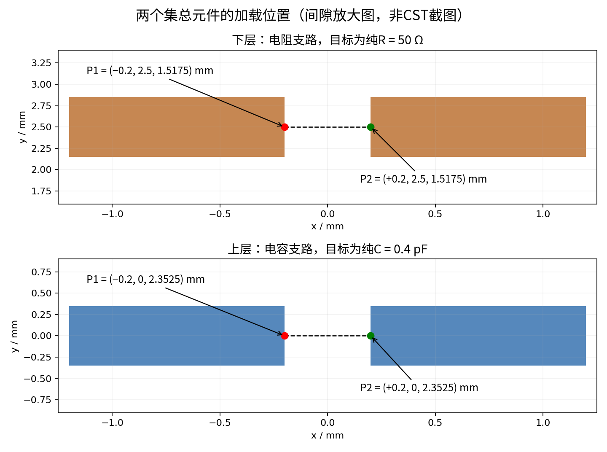

# CST 2023：先建立单元中的两个负载

本页只完成几何导入、R/C集总元件和原始History获取，不设置求解器或声称已经求解。不同界面布局可能改变命令入口；按功能名称查找，不依赖未经确认的菜单路径。

## 1. 下载并导入单元

打开仓库中的`models/unit/unit.step`，用GitHub文件页面的Download raw file保存到本机。CST 2023中新建微波3D工程，长度单位mm、频率单位GHz，使用Import/导入功能选择STEP文件。

保持模型原位置与全局坐标，不移动或自动居中；核对外形12×12×2.405 mm。两个负载坐标均为全局坐标。只选择一种几何入口，不能导入STEP后又运行几何宏而叠加一套实体。

## 2. 打开集总元件功能

查找`Lumped Element / 集总元件`，通常在Simulation及Sources and Loads相关功能组；若位置不同，可用界面提供的命令搜索或帮助查找功能名。它与`Discrete Port / 离散端口`不同，当前不创建激励端口。

建议先打开该对话框并截图确认字段，尤其是Type/RLC类型、R/L/C单位和端点输入。不要假定该版本一定提供单独的Resistor/Capacitor类型，也不要猜RLC Serial中数值0的特殊含义。

## 3. 两个元件的目标设置

| 元件 | 目标电气行为 | Point 1/mm | Point 2/mm |
|---|---|---|---|
| r00_c00_amplitude | 纯电阻50 Ω | (−0.2,2.5,1.5175) | (0.2,2.5,1.5175) |
| r00_c00_phase | 纯电容0.4 pF | (−0.2,0,2.3525) | (0.2,0,2.3525) |

电容单位：0.4 pF = 4e−13 F。根据输入框显示的单位填数，不能把0.4直接填入以F为单位的框。

优先使用对话框支持的显式坐标输入。两端应接触左右不同铜条的内侧面，不接地板；不要另画铜线跨过gap。若仅能拾取几何，需确认没有误选介质/底层地板，坐标式History更适合后续阵列复制。

如果Type只有RLC Serial等选项、纯R/C实现方式不明确，请先提供该对话框截图，再按实际字段确认设置。本文不替该版本发明复选框或将C=0解释为固定的开路/短路。

## 4. 获取原始History

创建成功后，打开History List，找到新增两个负载各自的创建记录。使用该窗口提供的查看/编辑命令入口读取原始命令文本，复制完整创建块。

用户只需提供原始记录，不需要替换占位符、修改名称或手写VBA。如果点击记录只打开参数窗口，先提供History List截图，再按实际入口确认；不要猜测存在某个固定的View code按钮。

第一轮需要的资料：一个50 Ω支路的原始创建记录、一个0.4 pF支路的原始创建记录，以及对话框显示的数值单位。取得记录后，桥接工具才能使用本机CST命令生成阵列加载宏。宏创建、负载连接、求解与收敛需分别验证。
