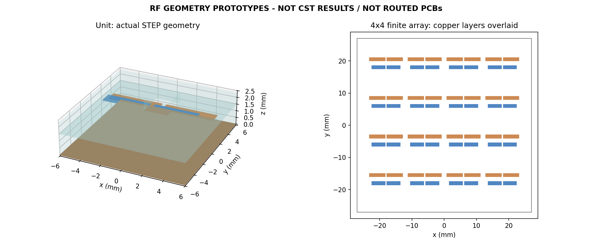

# 8 GHz 双谐振单元与有限阵列：实体几何 v1

本轮先落实单元和阵列结构。交付包括真实 STEP 实体、DXF 分层图、CST 几何宏、逐单元连接表及阵列测试状态。它们是**电磁几何样机**，尚非完成偏置布线的可编程 PCB；没有 CST 全波结果，不直接生成 Gerber 或送板加工。

用户已确认使用 **CST Studio Suite 2023**。当前优先推进[第一研究点实施基线](stage1_design_zh.md)：单元→真实器件→完整偏置→4×4；8×8暂不作为首块样机目标。[负载桥接工具](cst_bridge/README_zh.md)可将本机录制的R/C命令展开到各单元，不猜测未执行的CST接口。

初次操作请先看：[CST 2023：导入单元、建立两个负载并获取History](CST2023_first_two_loads_zh.md)，附加载位置放大图。

## 1. 现在具体做出了什么

| 模型 | 有效孔径 | 外形（含边框） | R/C加载数 | 几何文件 |
|---|---|---|---|---|
| 单元 | 12×12 mm | 12×12 mm | 2 | models/unit/unit.step |
| 4×4有限阵列 | 48×48 mm | 54×54 mm | 32 | models/array_4x4/array_4x4.step |
| 8×8有限阵列 | 96×96 mm | 102×102 mm | 128 | models/array_8x8/array_8x8.step |

厚度2.405 mm（含35 µm地板铜、1.5 mm底介质、35 µm下层铜/填充、0.8 mm上介质和35 µm上铜）。材料介电常数3.55、损耗角正切0.0027仅为通用初始值，不能据此指定商品基板。

STEP可通过本机CST的STEP导入功能读取，或在支持STEP的CAD软件中打开。DXF是二维RF/机械视图，不是带完整电气网表的PCB。CST宏尚未在CST执行，可作为STEP导入失败时的几何创建路径；不能把宏文件存在当成求解完成。



## 2. 与旧版相比的实质修正

旧版下层铜以外存在未明确填充的35 µm间隙。v1显式加入填充层，从中扣除下层铜和器件窗口，铜和介质不占据相同体积。阵列使用整块连续地板和介质，不把16/64块基板重叠堆砌。

下层R支路上方保留2.4×2.8 mm访问窗口，几何上避开上层相位条带。窗口仍是尺寸化占位；实际封装、焊料、工具空间、器件高度、层压和焊接流程需在选型后确认，不能把“有窗口”当成“可装配”。

该候选仍是双层加载条带的研究起点，并未证明自能工程、幅相解耦或结构新颖性。候选不满足物理目标时应改耦合拓扑，而不是直接扩大阵列。

## 3. 层叠及加载位置

- 地板：z=−0.035…0 mm。
- 下介质：z=0…1.5 mm。
- 辅助谐振铜：z=1.5…1.535 mm，沿x，长度10.5、宽1.2 mm，中心y=2.5 mm，gap=0.4 mm；加载R支路。
- 铜高填充层：z=1.5…1.535 mm，扣除铜与访问窗口。
- 上介质：z=1.535…2.335 mm，扣除窗口。
- 主谐振铜：z=2.335…2.37 mm，沿x，长度9、宽1.2 mm，中心y=0，gap=0.4 mm；加载C支路。

注意：表格厚度以最高铜面2.37减最低地板面−0.035计算为2.405 mm。所有图使用同一坐标。gap中没有额外金属跨接；加载器件使用CST集总支路连接左右铜体。

每个模型的 `load_endpoints_SI.csv` 给出两个端点（mm）、器件类型、理想值（Ω或F）、封装L（H）和串联R（Ω）示例。默认单元两组端点为：

```text
R支路：(-0.2, 2.5, 1.5175) → (+0.2, 2.5, 1.5175) mm
C支路：(-0.2, 0,   2.3525) → (+0.2, 0,   2.3525) mm
```

端点应分别接触不同铜条内侧面，并在CST电流图中验证。导入STEP时可能按版本合并/重命名实体，应按几何与材料重新确认。`IDEAL_LOAD` DXF线只是加载位置标记，不是应加工的铜线，否则会把器件短路。

## 4. 材料赋值与CST建模：先运行一个单元

### 4.1 两条几何入口

A. 导入`unit.step`：长度单位设mm；按实体/组件名称给ground和所有铜条赋铜，base/spacer给实际基板材料，interlayer_fill给实际填充材料；检查导入尺寸。STEP颜色不等于CST电磁材料。

B. 在新的空白CST项目运行对应`BuildGeometry.bas`：创建通用介质及铜材质、全部实体和频率范围。宏的实体范围是生成时的数值快照；改变几何应修改`build_hardware.py`顶部CFG并重新生成，不能只修改宏中的StoreParameter就期望数值实体自动变形。

不要在同一项目中同时导入STEP和运行几何宏，以免产生重叠实体。

### 4.2 集总元件及求解设置

本机GUI创建一个纯R支路和一个纯C支路，端点使用CSV。R=50 Ω，C=0.4 pF先作为固定基线。集总元件不是外部离散激励端口。CST不同版本的RLC API可能不同，本包没有伪造或宣称已执行该API。

先用周期单元：x/y为Unit Cell边界，从+z沿−z正入射，电场沿x，使用Floquet端口。识别共极化/交叉极化模式，不按模式序号猜极化。统一反射参考面，扫描6–10 GHz。准确的端口、边界和网格命令可由本机GUI录制History后用模板展开。

网格先在0.4 mm gap和器件附近局部细化，避免全域以铜厚均匀细分。至少两次有效加密后，建议有效幅度点|S|变化<0.01、相位变化<2°，并检查功率平衡；低幅度相位需单独处理。该门限是研发检查建议，不是已完成验证。

### 4.3 原理基线和寄生版本同时准备

- B1 主谐振层单独：保留相同地板和介质，移除辅助铜及R器件，比较C调谐。
- B2 辅助层单独：保留相同地板和介质，移除主铜及C器件，比较R调谐。
- B3 双层固定R/C：观察耦合后的谐振与电流分布。
- B4 双层两路调谐：检查真实二维可达域。

B1/B2保留相同介质/窗口是为了隔离金属谐振器作用；若改介质环境，应另列为不同物理对照。

理想R/C只作机理基线。寄生示例为L=0.4 nH，上层另有R=1.5 Ω；最终必须替换成所选器件的可靠模型。8 GHz下0.4 nH的感抗约20.1 Ω；配0.9 pF的串联自谐振约8.39 GHz，因此高电容端可能已经受到明显封装影响。不能先用理想状态选好大阵列，最后再补寄生。

## 5. 81状态及何时值得扩大阵列

原始R/C扫描范围仍可用于初筛：R={1,3,10,20,50,100,150,220,300} Ω，C={0.12,0.18,0.24,0.32,0.4,0.5,0.62,0.75,0.9} pF。电学状态和器件偏置电压/电流不是同一个量，实际偏置范围必须经器件校准。

先做3×3稀疏扫描排错，再做完整81状态。重点输出复反射状态云、固定C扫R的幅度/相位、固定R扫C的幅度/相位、吸收和交叉极化、电流分布及归一化Jacobian。相位覆盖与幅度范围必须分条件报告，不能把无效低幅度相位拼成完整控制能力。

只有在完整状态库显示有效独立控制，并且加入寄生后仍有任务价值，才将候选用于阵列性能优化。当前没有任何状态被预先认定为0/π或某个波束相位。

## 6. 4×4与8×8是有限阵列，求解设置不同

有限阵列设置全开放边界，使用规定极化的平面波或经过标定的喇叭照射。相同入射、功率归一化、监视平面和参考相位下，输出复近场、表面电流、散射远场/RCS和吸收功率。

**有限平面波阵列没有与周期Floquet单元相同含义的S11。** 不应将阵列远场或S21直接送入单元S11分析脚本。若用金属板作参考，应固定尺寸、参考面与照射条件；选择的归一化方法必须写入结果元数据。

每块阵列已提供四组 `load_patterns.csv`：均匀、R棋盘、C斜坡和固定种子的随机R/C。C斜坡不是已知相位梯度，不代表已完成波束设计。待真实状态库确定后才能选取相位梯度码。建议再增加均匀B、2×2块状AB，以及“中心单元固定、只改变邻居状态”的互耦测试。

比较局部周期状态库预测与显式有限阵列全波结果，分别检查边缘/内部单元、复场误差、主瓣与旁瓣差异。4×4用于连接与局部互耦预验证，8×8用于有限孔径混合编码；不能仅通过均匀阵列便宣称任意编码可预测。

## 7. 独立偏置还需要哪些实际设计

目前模型只有RF几何与理想加载位置，没有可制造的偏置电路或完整DC回路。一个器件有两个端子，两路调谐意味着各自明确的馈电与回流；不能把“两个调谐量”理解为仅需两根随意引线。

后续必须选定二极管封装与真实焊盘，设计并仿真RF/DC隔离、高阻线/滤波、接地隔离孔、过孔、驱动量程与温升。穿地信号孔必须设置反焊盘，避免短路。8 GHz下“大电感扼流”不能作为未经自谐振检查的万能假设。

建议制造前完成三版本比较：理想R/C、实际封装、实际封装+完整偏置。若采用2×2分组，阵列的独立控制自由度应按控制组而非物理铜图数计算。8×8逐单元两路调谐对应128个控制量；FPGA只是数字接口，仍需DAC/电流驱动及回路。

## 8. 本轮验证记录和仍未完成的事项

本包可验证的是：CAD实体合法性、间隙/层叠/负载端点、STEP往返导入与体积、DXF结构和阵列编号。检查结果写在`geometry_validation.json`，不能将其称为电磁验证。

尚未在CST运行宏、没有附加CST器件、没有设置实际求解器或做网格收敛；尚无幅相性能、效率、波束或定位结果；尚无加工文件和可编程样机。

当前最有用的外部输入是本机CST版本，以及一次单元求解或GUI录制的R/C加载History。得到真实周期单元数据后才能判断保留/修改哪一套几何，并将相同模型进一步推进有限阵列。
