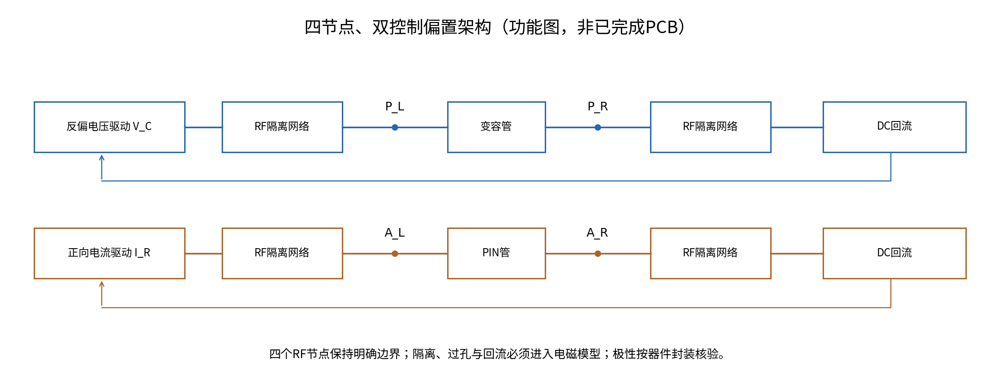

# 第一研究点实施基线：单元→加载/封装→偏置→4×4

目标CST版本：**CST Studio Suite 2023**（用户已确认）。当前云端没有该版本的安装或许可证执行环境；文件兼容性仍需本机验证。

这一阶段只验证幅相调控硬件，不开展定位、无人机或通信算法。现有v1为RF实体几何，不是已完成PCB。

## 1. 冻结的首轮RF结构

- 周期12 mm；上层主条带9×1.2 mm；下层辅助条带10.5×1.2 mm。
- 两层均为0.4 mm gap；下层中心偏移y=2.5 mm。
- 地板35 µm；底介质1.5 mm；铜高填充35 µm；层间介质0.8 mm；顶铜35 µm。
- 单元12×12 mm，厚2.405 mm；4×4有效48×48 mm，外形54×54 mm。
- 材料epsilon_r=3.55、tan_delta=0.0027仍为通用初值。正式加工前需要指定基板、填充材料与实际厚度。

这里的“冻结”只是固定比较基线，不代表尺寸已经最优，也不要求研究必须坚持双条带。若稀疏扫描表明模式耦合不合适，应修改谐振器/层间耦合。

## 2. 四个RF节点与两个独立控制量

主谐振器分成P_L与P_R，变容管跨接其间；辅助谐振器分成A_L与A_R，PIN管跨接其间。四个节点在RF上均不能被随意短接到地板。变容管由反偏电压控制，PIN由正向电流控制；图中的RF隔离网络必须用实际模型或几何实现，不是已经选定的“大电感”。

| 支路 | 所连接铜体 | 加载端点/mm | 首轮理想值 |
|---|---|---|---|
| 主谐振器C | r00_c00_phase_left/right | (−0.2,0,2.3525)→(0.2,0,2.3525) | 0.4 pF |
| 辅助谐振器R | r00_c00_amplitude_left/right | (−0.2,2.5,1.5175)→(0.2,2.5,1.5175) | 50 Ω |

变容管正反极性及PIN正向方向按真实封装引脚定义确认；图为功能电路，不是封装焊盘图。两个DC回路可在驱动侧共参考，但将某一RF半条直接接RF地会改变原结构，必须作为新结构重新仿真。

## 3. 三个必须通过的门槛

| 门槛 | 实际要完成的工作 | 未通过时的行动 |
|---|---|---|
| G0：理想单元 | 单元中真正建立R/C支路、Floquet激励、稀疏扫描与收敛；检查电流是否经过器件 | 先排查连接/端口，再改变长度、间距或谐振拓扑；不扩大阵列 |
| G1：真实封装 | 核验器件模型、极性、焊盘/焊料与装配窗口；加入寄生并重扫 | 更换器件或频段、修改耦合；不把理想可达域当实物能力 |
| G2：完整偏置 | 四节点的馈电/回流、RF隔离、过孔反焊盘、控制驱动与温升；比较有/无偏置 | 调整偏置网络与孔位；未完成前不输出生产Gerber |

G0通过后即可准备4×4小阵列模型，G1/G2不能拖到整阵列制造完成后再补。8×8目前只保留几何，不作为首块样机目标。

## 4. CST 2023的第一轮，只建立一个单元

1. 在CST 2023新建空白高频项目。导入 `models/unit/unit.step` 或运行同目录 `BuildGeometry.bas`，二者择一。
2. 若导入STEP，按名称给实体赋材料；STEP颜色不等于电磁材料。核对12×12×2.405 mm外形和两处0.4 mm间隙。
3. 用Lumped Element功能创建一个纯R支路和一个纯C支路，使用上表端点；它们不是用于激励的Discrete Port。确认0.4 pF在内部命令中的单位。
4. 周期边界、+z入射沿−z、x极化Floquet激励；识别正交基模。地板阻挡透射，保持全部状态相同参考平面。
5. 首次只解R=50 Ω、C=0.4 pF的6–10 GHz。观察谐振、复反射和加载电流；对gap/器件区域局部细化。
6. 再以R={5,50,220} Ω、C={0.18,0.4,0.75} pF做9状态排错。这个表是探索范围，不是器件安全偏置或有效状态的保证。
7. 至少用代表状态网格加密复查；有效幅度点建议|S|变化<0.01、相位<2°，并检查功率。窄谐振需独立频点核对，不能仅依赖插值。
8. 若模式和控制方向合理，再做完整81状态，输出同/交叉极化复反射、电流、功率与归一化Jacobian。

## 5. 不凭未验证的VBA接口批量加载

现已收到用户本机CST 2023创建R_amp/C_phase的真实History与截图，已经据此生成负载宏。该API来源已确认，但宏未在云端CST执行，接触电流、材料和求解仍需验证。

上表两个器件的原始记录已经保存到cst_bridge/recorded_2023；相应单元2个、4×4的32个、8×8的128个支路宏已生成到cst_bridge/generated_2023。当前已有R_amp/C_phase的用户工程不能再重复附加元件。

如果History使用面拾取而非坐标，应在本机改为显式坐标录制，不能让复制出的所有负载都连接到第一个单元。宏创建成功、负载连接成功、求解成功与网格收敛应分别记录。

## 6. 物理验证的四组对照

- 主层单独（保持相同介质/窗口），扫描C。
- 辅助层单独（保持相同介质/窗口），扫描R。
- 双层固定R/C，识别耦合前后的模式与电流。
- 双层两路调谐，检查实际有效二维可达域。

相位响应可计算J=∂(A,φ/2π)/∂(u_R,u_C)，对控制量归一化；低幅度相位需要屏蔽或用复数导数处理。除条件数外同时报告最小奇异值和实际调节幅度，避免两个方向都很弱却条件数“很好”。R/C坐标下的结论还不能直接当V/I坐标下的器件性能。

不强求完美对角Jacobian。允许一条控制路径有可补偿的交叉耦合；关键是存在稳定、有用的两个响应方向，并付出可接受的效率、带宽和功耗代价。

## 7. 器件与偏置选型的待办

| 项目 | 当前依据 | 进入G1/G2前必须获得 |
|---|---|---|
| 变容管 | Self论文使用MA46H120，可作候选参考 | 可靠V–C/Q/寄生、封装极性与焊盘、可采购状态、安全偏置 |
| PIN管 | Self论文使用BAP70-02，可作候选参考 | 高频I–R/结电容/封装模型、极性与焊盘、功耗与温度 |
| RF隔离 | 需要四节点馈电/回流 | 真实宽带模型和自谐振，或可制造高阻线/滤波结构 |
| 过地馈通 | 当前没有 | 过孔与反焊盘、回流、隔离及其电磁扰动 |
| 层叠与窗口 | 通用材料/尺寸化占位 | 真实材料模型、层压/焊接流程、器件高度与返修空间 |

以上器件名称来自已读论文，不是最终BOM，也不能替代官方模型与本机复核。示例0.4 nH在8 GHz的感抗约20 Ω；C=0.9 pF时串联自谐振约8.39 GHz，必须与理想模型并列检查。

## 8. 4×4的准入与独立控制

用与单元一致的材料、封装、偏置和模型，设置开放边界与平面波或真实喇叭照射。至少比较均匀、AB交替/块状和混合编码，检查中心单元固定而邻居改变的响应差异。有限阵列看散射场、近场、电流与功率，不套用周期单元S11。

4×4逐单元两路调谐需要32个控制量，8×8需要128个；实际驱动至少需相应电压/电流通道或经验证的复用保持网络。若为减小硬件复杂度使用2×2分组，必须同步改写可实现码本和自由度，不能保留逐单元任意棋盘/随机能力的说法。

## 9. 本轮推进状态

已完成：单元与有限阵列实体几何、几何与端点验证、四节点偏置功能架构、G0/G1/G2验证计划、真实History的负载展开工具及其文本处理自检。

未完成：CST 2023实机加载/求解、真实器件与偏置网络、单元电磁性能和PCB制造。两个负载创建记录已收到。当前外部前提是确认本机当前单元的材料、接触电流、激励/边界与单状态求解结果；不能以新增几何或文本文件代替这个验证步骤。
